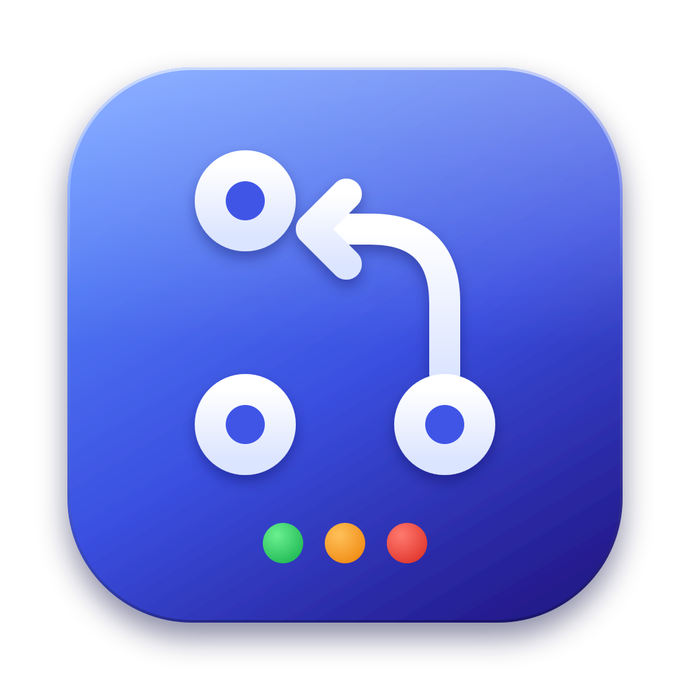
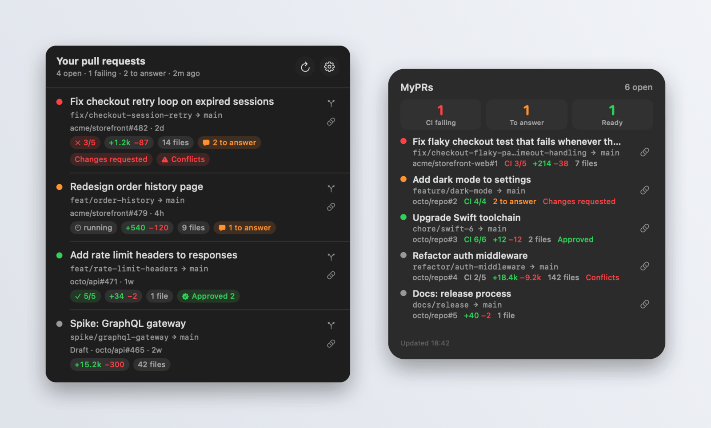
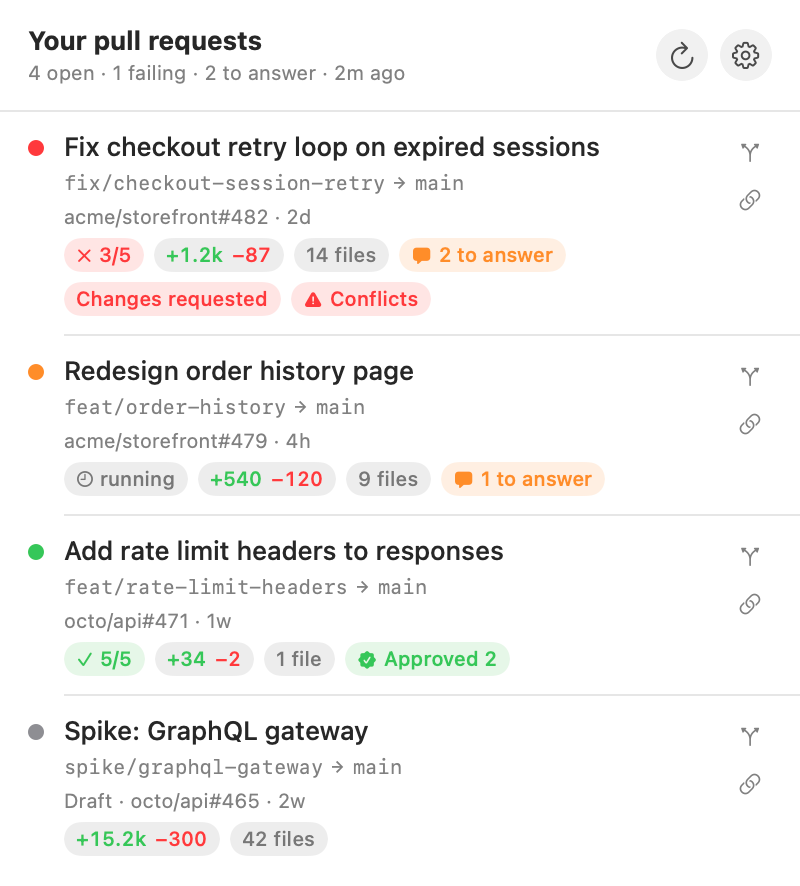
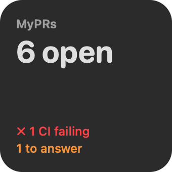
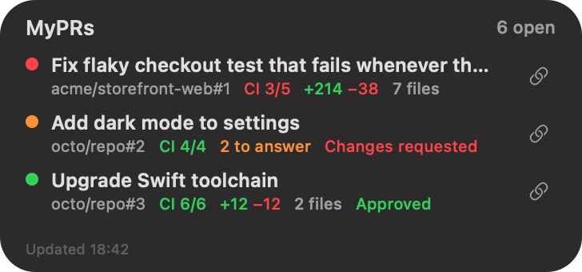
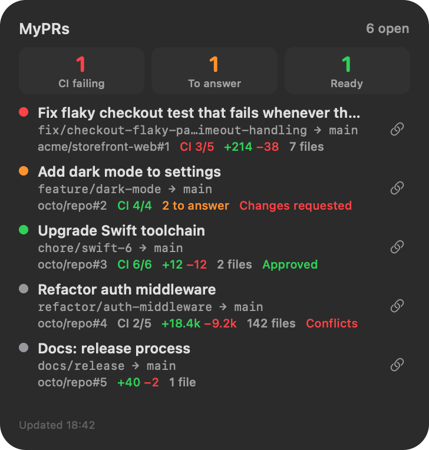
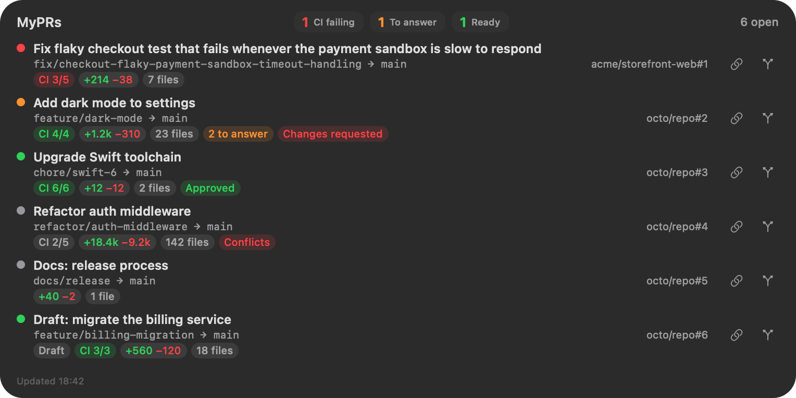

<p align="center">
  
</p>

<h1 align="center">MyPRs</h1>

<p align="center">
  Your open GitHub pull requests, one glance away in the macOS menu bar.
</p>

<p align="center">
  <a href="https://github.com/jaugustodafranca/myprs/actions/workflows/ci.yml"></a>
  <a href="https://github.com/jaugustodafranca/myprs/releases/latest"></a>
  
  <a href="LICENSE"></a>
</p>

## Screenshots

<p align="center">
  
</p>

<p align="center">
  <picture>
    <source media="(prefers-color-scheme: dark)" srcset="assets/screenshots/panel-dark.png">
    
  </picture>
</p>

| Small | Medium |
| :---: | :---: |
|  |  |
| **Large** | **Extra large** |
|  |  |

## What it does

- Lists your open pull requests in the menu bar and in a desktop widget
- Shows CI status for each PR: passing, running or failing
- Sends a notification when CI starts failing or a PR gets new unanswered threads
- Counts unanswered review threads so nothing waits on you unnoticed
- Shows review status: approved, changes requested or pending
- Opens a PR or copies its link in one click
- Updates itself with Sparkle

## Install

1. Download the latest `.dmg` from [GitHub Releases](https://github.com/jaugustodafranca/myprs/releases/latest).
2. Drag MyPRs to Applications and open it.

Requires macOS 14 or later. After the first install, updates arrive automatically through Sparkle. Maintainers: see [docs/release.md](docs/release.md) for how to cut a release.

## Sign in & privacy

- Sign in with GitHub through a standard browser redirect. The app requests the `repo` scope to read private repositories and `read:org` to see which of your organizations have not approved MyPRs.
- Your token is stored in the macOS Keychain.
- The app talks only to `api.github.com`.
- A tiny Cloudflare Worker exchanges the OAuth code for a token and stores nothing.
- GitHub hides pull requests from organizations that restrict third-party apps until they approve MyPRs. The panel shows a banner with a **Request access** button for each such organization. You can also use **Organization access…** in the settings to open [your authorized apps page](https://github.com/settings/connections/applications/Ov23li7Ghr091fkSv2eG) and grant access.

## Build from source

Requirements: macOS 14+, Xcode, [XcodeGen](https://github.com/yonaskolb/XcodeGen).

```bash
brew install xcodegen
xcodegen generate
open MyPRs.xcodeproj
```

Run the tests:

```bash
xcodebuild test -project MyPRs.xcodeproj -scheme MyPRs -destination 'platform=macOS' CODE_SIGNING_ALLOWED=NO
```

Worker:

```bash
cd worker && npm ci && npm test && npx tsc --noEmit
```

## Project layout

```
App/        Menu bar app
Widget/     Widget extension
Shared/     Types shared by app, widget and tests
Tests/      Unit tests
worker/     Cloudflare Worker for the OAuth code exchange
scripts/    Release helpers
docs/       Specification and release guide
assets/     Logo
.github/    CI and release workflows
```

See [docs/spec.md](docs/spec.md) for the design and [AGENTS.md](AGENTS.md) for contributor rules.

## License

[MIT](LICENSE)
